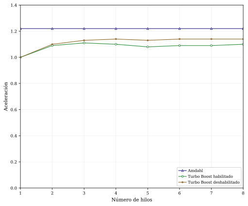

# Ley de Amdahl

_Lunes 02 de noviembre, 2026_

<hr/>

## Problema

A partir de un programa que sume matrices cuadradas de un tamaño considerable con entradas de tipo `double`, medir su tiempo de ejecución variando el número de hilos. Graficar la aceleración obtenida en dos configuraciones: con la tecnología Turbo Boost habilitada y deshabilitada.

## Plataforma de ejecución

- MacBookPro Intel® Core™ i7-7920HQ × 8
- Sistema Operativo: Ubuntu 26.04.1 LTS
- Kernel: Linux 7.0.0-42-generic
- Frecuencia base: 3.1 GHz
- Frecuencia máxima: 4.1 GHz
- Memoria: 16 GiB

## Consideraciones

- Para deshabilitar el Turbo Boost se ejecutó el siguiente comando: `echo "1" | sudo tee /sys/devices/system/cpu/intel_pstate/no_turbo`. Un resultado de `1` al ejecutar `cat /sys/devices/system/cpu/intel_pstate/no_turbo` indica que está deshabilitado.
- El tamaño de las matrices se fijó en $N = 20,000$.
- El siguiente programa se compiló sin bandera de optimización y se ejecutó para distintos números de hilos. Para cada caso se ejecutó el programa 5 veces y se tomó el promedio de la muestra.
```C
#include <stdlib.h>
#include <stdio.h>
#include <math.h>
#include <omp.h>

double *A, *B, *C;

int main(int argc, char **argv)
{
    u_int64_t N = 20000;

    A = (double *)malloc(N * N * sizeof(double));
    B = (double *)malloc(N * N * sizeof(double));
    C = (double *)malloc(N * N * sizeof(double));

    size_t i, j, n;

    n = (argc > 1) ? atoi(argv[1]) : 1;

    double t0, t1, t2;

    t0 = omp_get_wtime();

    for (i = 0; i < N; i++)
    {
        for (j = 0; j < N; j++)
        {
            A[i * N + j] = (double)(i + j);
            B[i * N + j] = M_PI * (double)(i + j);
            C[i * N + j] = 0.0;
        }
    }

    t1 = omp_get_wtime();

#pragma omp parallel for num_threads(n) private(j)
    for (i = 0; i < N; i++)
    {
        for (j = 0; j < N; j++)
        {
            C[i * N + j] = A[i * N + j] + B[i * N + j];
        }
    }

    t2 = omp_get_wtime();

    printf("tiempo secuencial: %lf\n", t1 - t0);
    printf("tiempo paralelo: %lf\n", t2 - t1);
    printf("tiempo total: %lf\n", t2 - t0);

    return 0;
}
```

## Resultados

### Turbo Boost habilitado

$T(N, p)$ es el tiempo de ejecución con $p$ hilos y un tamaño de problema $N$. $\Psi(N, p)$ es el incremento relativo de rendimiento sobre el mismo tamaño de problema $N$ con $p$ hilos de ejecución:

$$
\Psi(N, p) = \frac{T(N, 1)}{T(N, p)}.
$$

|$p$  | $T(N, p)$ [s] | $\Psi(N, p)$ |
|:---:|:-------------:|:------------:|
|1    | 5.9           | 1            |
|2    | 5.42          | 1.09         |
|3    | 5.33          | 1.11         |
|4    | 5.35          | 1.1          |
|5    | 5.45          | 1.08         |
|6    | 5.41          | 1.09         |
|7    | 5.43          | 1.09         |
|8    | 5.37          | 1.1          |

### Turbo Boost deshabilitado

|$p$  | $T(N, p)$ [s] | $\Psi(N, p)$ |
|:---:|:-------------:|:------------:|
|1    | 7.57          | 1            |
|2    | 6.87          | 1.1          |
|3    | 6.72          | 1.13         |
|4    | 6.62          | 1.14         |
|5    | 6.69          | 1.13         |
|6    | 6.65          | 1.14         |
|7    | 6.63          | 1.14         |
|8    | 6.66          | 1.14         |

### Límite de aceleración

De la ley de Amdahl se obtiene la aceleración máxima que puede obtenerse. Para ambos casos (Turbo Boost habilitado y deshabilitado), este valor es $\frac{1}{f} = \frac{1}{0.82} = 1.22$.

La siguiente gráfica muestra las aceleraciones comparadas con el límite.

<center>
    <figure>
    
    <figcaption>Comparación de aceleraciones</figcaption>
    </figure>   
</center>
