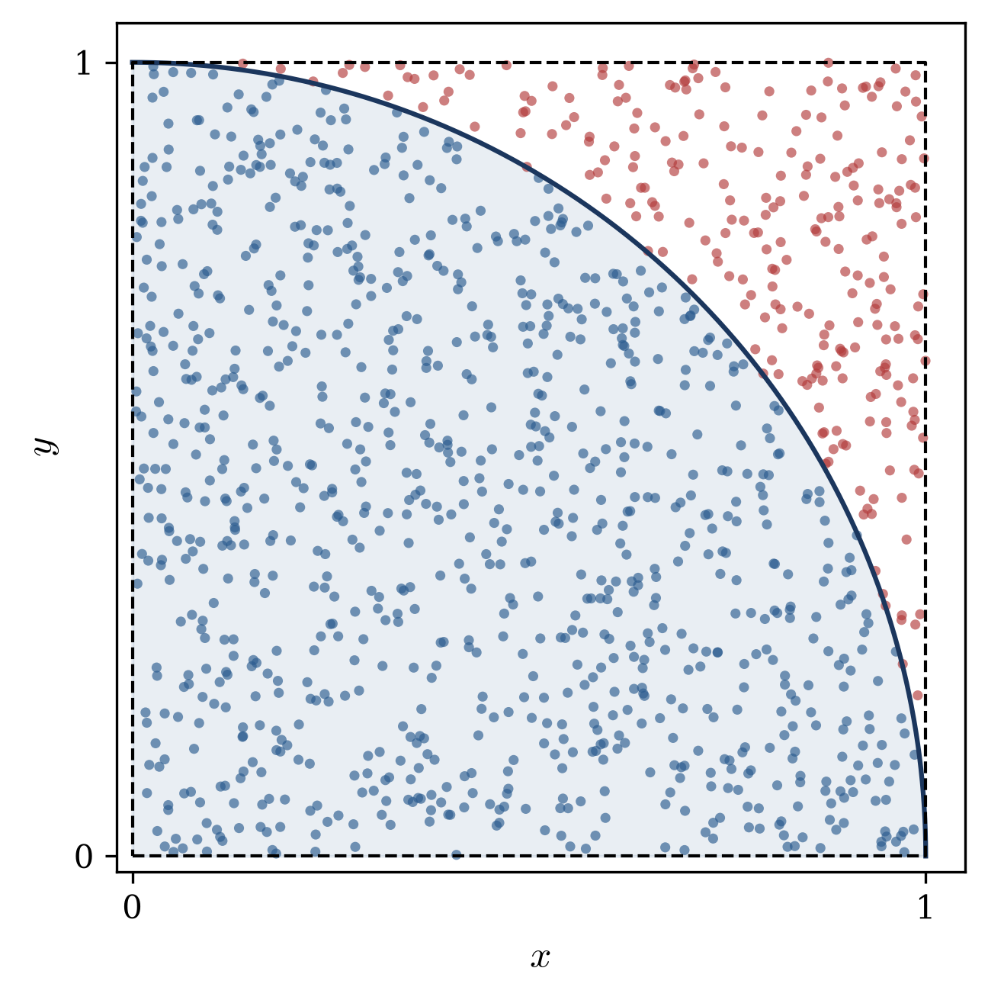

# Paralelización del método de Monte Carlo para la estimación de $\pi$

_Noviembre 24, 2026_

<hr/>

## Problema

Implementar un algoritmo paralelo tipo Monte Carlo usando OpenMP para estimar el valor de $\pi$.

## Análisis

Un algoritmo tipo Monte Carlo para estimar $\pi$, consiste en generar una muestra aleatoria de puntos dentro de un cuadrado que encierra un cuarto de circunferencia de radio unitario y calcular la proporción de puntos que caen dentro de la circunfencia del total de puntos.

<center>
    <figure>
    
    <!-- <figcaption></figcaption> -->
    </figure>   
</center>

Considerando la figura anterior,

$$
\pi \approx 4 \cdot \frac{|EE|}{|NE|}
$$

donde $EE = \{ (x, y) : x^2 + y^2 \leq 1 \}$ es el conjunto de puntos azules y $NE$ es el conjunto de puntos en el cuadrado unitario (azules y rojos). $|\cdot|$ denota el número de elementos en un conjunto.

## Solución

### Generación de números aleatorios

Para generar la muestra aleatoria de puntos se usó la función `ran2` del _Numerical Recipes in C_ con las modificaciones para que sea reentrante. La función `ran2` es un generador de números aleatorios con distribución uniforme y con un periodo mayor que $2\times 10^{18}$. Para los propósitos de este trabajo, genera números aleatorios más que suficientes. Los números que genera están en el intervalo abierto $(0.0, 1.0)$.

```C
ran2 no reentrante

ran2(long *idum)
{
  static long idum2 = 123456789;
  static long iy = 0;
  static long iv[NTAB];
  ...
}
```

La función `ran2` original depende de variables estáticas. Los valores de estas variables se compartirían entre distintos hilos de ejecución. Una alternativa es la siguiente:

```C
ran2 reentrante

ran2_r(cryptic_data_t *r)
{
    // no hay definición de variables estáticas idum2, iy, iv,
    // estas variables se pasan como parámetros.
}
```

donde `cryptic_data_t` es una estructura con las variables `idum, idum2, iy, iv`:

```C
struct cryptic_data
{
  long idum;
  long idum2;
  long iy;
  long iv[32];
};

typedef struct cryptic_data cryptic_data_t;
```

Cuando se ejecuta `ran2_r` con el parámetro `r->idum` siendo negativo, el generador asigna o modifica los valores a las variables de estado `r->idum2, r->iy, r->iv`. Estas variables no son compartidas por distintos hilos de ejecución; cada hilo mantiene en su `stack` su conjunto de variables. Para generar los siguientes números aleatorios de la sucesión, en ejecuciones sucesivas no se modifica el valor del parámetro `idum`.

### Paralelización

Cada hilo de ejecución mantiene su propia estructura de variables de estado para `ran2_r`:

```C
#pragma omp parallel
{
    cryptic_data_t r;
    r.idum = -(time(NULL) + omp_get_thread_num());
    r.idum2 = 123456789;
    r.iy = 0;
    ...
}
```

`idum` debe ser un entero negativo único para cada hilo; `time(NULL)` es útil en este caso, sin embargo puede ocurrir que dos hilos o más obtengan el mismo entero. Para evitar esto, se suma el identificador del hilo en ejecución.

Cada hilo de ejecución genera una porción de $NE$ de puntos aleatorios $(x, y)$ y cuenta aquellos que caigan dentro del cuarto de círculo.

```C
#define NE <entero muy grande>
...
size_t EE = 0, i;
{
    ...
    float x, y;
#pragma omp for reduction(+ : EE)
    for (i = 0; i < NE; i++)
    {
      x = ran2_r(&r);
      y = ran2_r(&r);
      if ((x * x + y * y) <= 1.0)
      {
        EE++;
      }
    }
}
```

## Resultados

### Plataforma de ejecución

| | Raspberry Pi 5 |	
| :--------: | :----: |
| Procesador | Broadcom BCM2712 Arm Cortex-A76 |
| Frecuencia | 2.4 GHz |
| Núcleos | 4 |
| Arquitectura | Arm64 |
| Memoria | 16 GB |
| Sistema operativo | Debian GNU/Linux 13 (trixie) |


La siguiente tabla lista los tiempos de ejecución promedio de 5 realizaciones. La mejor estimación de $\pi$ conseguida recupera $4$ posiciones después del punto: $3.1415$. 

**Tiempos de ejecución**

$NE = 1,000,000,000$

| # de hilos | Tiempo de ejecución [s] |
| :--------: | :---------------------: |
| 1 | 73 |
| 2 | 36 |
| 3 | 24 |
| 4 | 18 |