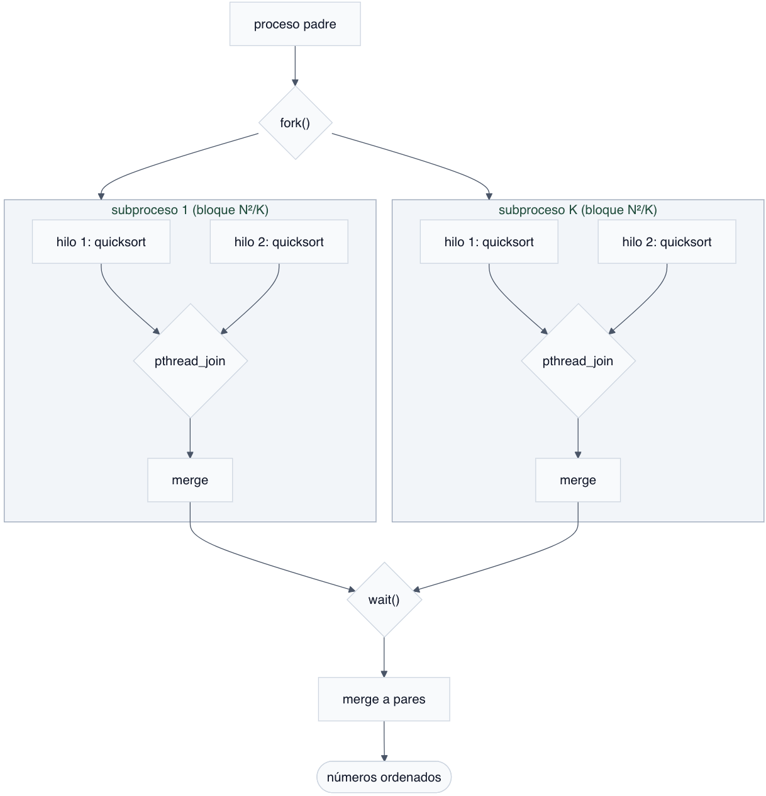

# Ordenamiento concurrente
## Proyecto para la asignatura _Tópicos selectos de cómputo de alto rendimiento_.

_Realizaron: JBC_ y _HMC_.

_Noviembre 2026_

---

## Problema

Dada una matriz de números reales de tamaño $N \times N$, con $N >> 1$, desarrollar un programa en C que ordene de forma ascendente estos números y los almacene en un archivo. El programa debe usar procesos e hilos.

## Consideraciones

- Se consideran los datos contenidos en el archivo de texto provisto `matriz_a.txt`. Con estos datos, $N = 40,000$.
- El programa guarda los números ordenados en el archivo binario `matrix.bin`.

## Análisis de la solución

Si se tiene que procesar una cantidad "grande" de datos y, por suerte, tenemos un procesador multi núcleo a la mano, una decisión, cuando menos sensata, es aprovechar todos los núcleos para el procesamiento y así reducir el tiempo de ejecución. Esto requiere un programa que, en efecto, aproveche todos los núcleos.

En este trabajo se siguió una estrategia "divide y vencerás". El conjunto de $N^2$ números se divide en $K$ bloques, donde $K$ es el número de núcleos físicos disponibles. Si $N^2$ es un múltiplo de $K$, el tamaño de cada bloque es $N^2 / K$. En otro caso uno de los bloques tendrá tamaño $N^2 \mod K$. El _proceso padre_ asigna cada bloque a un _subproceso_. Cada proceso se ejecutará en un núcleo, no necesariamente el mismo durante todo el tiempo de ejecución del programa. La segmentación de los datos es lógica, en el sentido de que toda la matriz de datos reside en la memoria virtual y a cada subproceso se le indica el par de índices que determinan los límites de su bloque de datos.
Cada subproceso, a su vez, crea un par de hilos para reducir aún más el tamaño de la unidad de trabajo. Esta segmentación también es lógica. Cada hilo ordena con la implementación estándar en C de _quicksort_. Luego, cada subproceso combina los ordenamientos parciales de sus hilos. Finalmente el proceso padre combina _a pares_ los ordenamientos parciales de los subprocesos.

```text
OrdenamientoConcurrente(números)

1  K ← número de núcleos
2  N ← cantidad de números por ordenar
3  *B ← Cargar en memoria los números
4  *B_i ← Dividir B en K bloques
5  for i ← 0 .. K - 1
6    Crear subproceso i
7      for j ← 0 .. 1
8        Crear hilo j
9          ordenamiento_parcial_j ← quicksort(B_ij)
10       Esperar hilo j
11     Combinar ordenamientos parciales de hilos
12   Esperar subproceso i
13 Combinar ordenamientos parciales de subprocesos
```

<center>
    <figure>
    
    <figcaption>Diagrama de flujo de OrdenamientoConcurrente</figcaption>
    </figure>   
</center>

Las instrucciones que derivan de la línea 3 de `OrdenamientoConcurrente` se incluyen en la función `parse`. Dado que los subprocesos manipulan simultáneamente diferentes segmentos del mismo espacio de memoria, `parse` devuelve la dirección de la memoria virtual asignada y configurada para compartir. Los datos se leen como `float`s desde el archivo de texto. Para la línea 4 se implementó la función `divide`. Esta función entrega los índices que delimitan los bloques de números que cada subproceso ordena. En el proceso padre se crean los $K$ subprocesos con llamadas al sistema `fork`. Cada subproceso crea y ejecuta 2 hilos utilizando la función `pthread_create()` de la biblioteca `pthread`. Una vez que los hilos concluyen el ordenamiento de sus respectivos bloques (línea 11), la función `merge`, invocada por cada subproceso, combina los bloques ordenados. En la línea 1, el proceso padre combina todos los ordenamientos parciales; usa la función `merge_partitions`. Si $K = 4$, `merge_partitions` combina $B_0$ con $B_1$ y $B_2$ con $B_3$. Luego $B_0 B_1$ con $B_2 B_3$, resultando $B \equiv B_0 B_1 B_2 B_3$ ordenado.

## Resultados

### Plataformas de compilación y ejecución

| Componente | Plataforma 1 | Plataforma 2 |
| :---: | :---: | :---: |
| **Procesador** | Intel Core i7 7920HQ | AMD Ryzen 7 6800H |
| **Núcleos** | 4 (2 hilos $\times$ núcleo) | 8 (2 hilos $\times$ núcleo) |
| **Frecuencia base** | 3.1 GHz |3.2 GHz |
| **Memoria RAM** | 16 GB LPDDR3 (2133 MHz) | 32 GB |
| **Sistema Operativo** | macOS Ventura 13.7.8 | Ubuntu 22.0.1 LTS |
| **Compilador** | Apple clang version 14.0.3 | gcc |

### Tiempos de ejecución

Los tiempos de ejecución se midieron con la función `clock_gettime` de la biblioteca `time` (utilizando `CLOCK_MONOTONIC`), lo que proporciona una resolución de nanosegundos.


### Con parámetro "y" escritura de archivo

#### **1 proceso**

* **Panel resources Ubuntu:** 
* **Tiempos:** 

> **Tiempo ordenamiento sort:** 211.47 segundos

#### **8 procesos**

* **Panel resources Ubuntu:** 
* **Tiempos:** 

* **Comando top:** 
* *Resultado 8 procesos*

> **Tiempo ordenamiento sort :** 40.31 segundos

---

### **Gráfica Procesos vs tiempo de ejecución**


* *Procesos vs Tiempo Escritura*

---

### Con parámetro "n" sin escritura de archivo

#### **1 proceso**

* **Tiempos:** 
* *Resultado 1 proceso*

> **Tiempo ordenamiento sort :** 207.27 segundos

#### **8 procesos**

* **Tiempos:** 
* *Resultado 8 procesos*

> **Tiempo ordenamiento sort :** 40.65 segundos

---

### **Gráfica Procesos vs tiempo de ejecución**


* *Procesos vs Tiempo Sin escritura*

